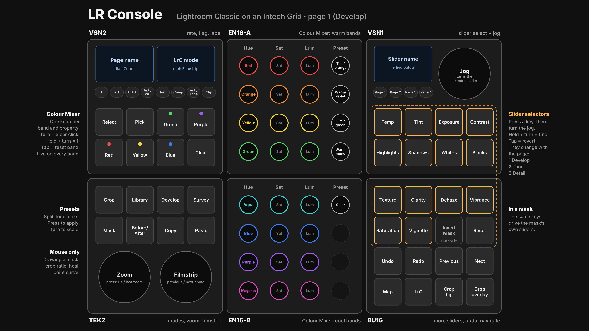

# LR Console

A six-module [Intech Grid](https://intech.studio) controller for Adobe Lightroom Classic, plus a fork of Intech's Lightroom plugin that lets the board read Lightroom's state as well as send commands to it.



**Video:** _link to follow_ · **Forum thread:** _link to follow_

## What it does

- **One jog wheel drives whichever slider is selected.** Sixteen keys under the jog choose the slider. Turn for coarse, hold and turn for fine, tap to undo the current turn, and hold for 0.6 s to reset to Adobe's default.
- **The board follows Lightroom, not just the other way round.** Move a slider with the mouse and the board selects it. Open a mask and the same sixteen keys drive that mask's sliders. Enter Crop and the jog straightens. Label and flag keys light up when the current photo has that label or flag.
- **Screens show real values.** The VSN1 screen shows the selected parameter and its live value, echoed back from Lightroom up to 20 times a second. It also shows a reply counter, so you can tell a stale reading from a resting one.
- **The Colour Mixer is always available.** Two EN16s carry Hue, Saturation and Luminance for all eight bands, plus four one-press split-tone presets. Spinning a preset scales its strength.
- **Four pages:** Develop (Basic panel and vignette), Tone (parametric curve and colour grading on two dials), Detail (sharpening, noise, vignette, grain), and a spare page. Culling, labels, views, Crop, Mask, Before/After, Copy/Paste and Undo/Redo stay on the same keys on every page.

The full keymap is in [docs/LAYOUT.md](docs/LAYOUT.md).

## How it was made, and the AI part

I designed the layout, bought and assembled the hardware, and tested every change on the board while editing real photos. Almost all of the code (the Python generator, the Grid Lua it emits and the plugin changes) was written by Claude (Anthropic's AI) in conversation with me, over about ten weeks of evenings between August and October 2026. I don't write Python. I described what I wanted, tested the result and reported what happened, and we iterated.

That is why the docs look the way they do. Every claim is marked **[M]** measured, **[S]** read from source, **[I]** inferred or **[?]** assumed. The AI was confidently wrong often enough that we stopped trusting anything that hadn't been measured on the board. [docs/CODE-REFERENCE.md §14](docs/CODE-REFERENCE.md) lists the beliefs that turned out to be false.

## What's in here

| Folder | What it is | Who it's for |
|---|---|---|
| [`plugin/`](plugin/) | The Lightroom plugin fork (`lrconsole.lrdevplugin`, v0.2.16) | **Anyone with a Grid and Lightroom.** It's the part most worth reusing. |
| [`generator/`](generator/) | Python that writes the Grid Editor `.json` profiles. Never hand-edit Lua on the module. | Anyone building their own layout |
| [`configs/`](configs/) | The 16 profiles currently on my board (build `r1020-1040`) | People with exactly my six modules in exactly my arrangement |
| [`hammerspoon/`](hammerspoon/) | Three lines that let a board key bring Lightroom to the front | Mac users |
| [`docs/`](docs/) | Layout, code reference, bench findings: the working notes from the build | Anyone going deeper |

## Hardware

VSN1 (left-screen version), VSN2, TEK2, BU16 and 2× EN16 (detented), on a 3 mm Dibond plate with Dual Lock tape. Seated, far row first:

```
VSN2  (upright)   EN16-A (270°)   VSN1  (USB host)
TEK2  (180°)      EN16-B (270°)   BU16  (upright)
```

The rotations matter: the code maps physical keys to element numbers with them. Module positions live in one table (`generator/lr_common.py`, `POS_FLIPPED`).

## Requirements and limits

- **macOS.** Only tested on a Mac. The plugin should run on Windows, but the LrC focus key needs Hammerspoon and the keystroke codes assume Mac shortcuts.
- **Lightroom Classic** with Intech's **Lightroom Classic package** installed in Grid Editor. The fork replaces the plugin half only; the Editor package is stock.
- **Grid Editor 1.7.x and Grid firmware 1.5.x** as of October 2026. Later firmware changed Lua number handling, which may affect the dial maths. Untested.
- **As-is, no support.** I'll read issues, but this is a hobby project.

## Quick start

1. **Plugin:** follow [plugin/README.md](plugin/README.md). Disable the stock Grid plugin, add this one, then restart Lightroom.
2. **Configs (only if your hardware matches mine):** copy `configs/*.json` into `~/Documents/grid-userdata/configs/`. In Grid Editor, for each page and each module: Clear, load the matching profile, then Store. Do one page at a time across all six modules, because page switching is slow.
3. **Hammerspoon (optional):** add [hammerspoon/init.lua](hammerspoon/init.lua) to `~/.hammerspoon/init.lua`.
4. **Different hardware or layout:** see [generator/README.md](generator/README.md).

## Things the Grid docs don't tell you (that cost us days)

- **The Lightroom package delivers one `develop` message per 50 ms and drops the rest.** A fast spin used to cover a sixth of a slow one. Batch your sends.
- **`eventrx_cb` only fires on VSN-family modules.** TEK2 and EN16 never receive it. MIDI CCs between modules (`midi_send` → `midirx_cb`) reach every module.
- **LED layer `-1` does nothing.** `led_value` gates the LED on and off; the alpha in `led_color` sets brightness.
- **`endless_state() - 64` is a velocity sampled at about 110 Hz,** not a step count. One revolution sums to about 91,000 at any speed.
- **The Editor shadows a local profile with its cloud copy** if the name and id haven't changed. Every build here carries a timestamp in its name.
- **After any plugin change, restart Lightroom.** "Reload Plug-in" starts the new code while the old instance keeps the port and keeps answering.

Details and evidence are in [docs/CODE-REFERENCE.md](docs/CODE-REFERENCE.md).

## Credits and licence

The plugin fork is derived from the plugin in Intech Studio's [package-lightroom-classic](https://github.com/intechstudio/package-lightroom-classic) (its `package.json` declares ISC; the repo has no separate LICENSE file). See [plugin/NOTICE](plugin/NOTICE). Everything else is © 2026 CJ Selby Spink, MIT licence ([LICENSE](LICENSE)). Thanks to Intech Studio for open hardware that rewards this kind of tinkering, and for patient support with two faulty modules.
