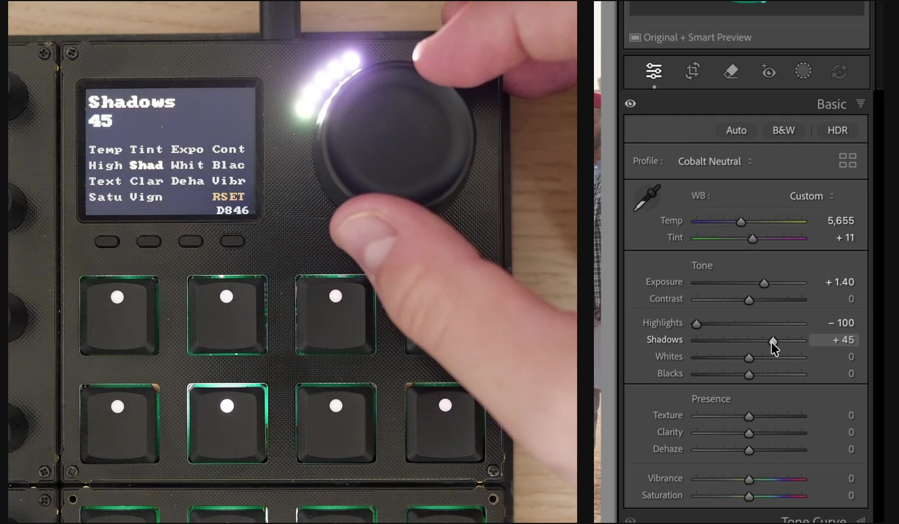

# LR Console plugin (fork of Intech's Lightroom plugin) — v0.2.16

Intech's Grid Editor package talks to Lightroom Classic through a small Lightroom plugin. The stock plugin takes commands from the board (develop a slider, set a flag, change a view) and answers only with the active photo's EXIF. **This fork makes the conversation two-way**: the board learns what Lightroom is doing and can show it.

It's a drop-in replacement for the plugin half only. The Grid Editor package (`index.js`) stays stock and unchanged. Any Grid layout can use these commands and replies; you don't need my board.



*The board's screen showing the value Lightroom reports, after the slider was dragged with the mouse.*

## What it adds

**Replies with state.** The package turns the plugin's reply into a call to `LrImportActive(...)` on every module. The fork reuses the stock reply's fields to carry:

```
LrImportActive(id, MODULE, LABEL, PARAM, VALUE, rating, flag)
```

| Field | Meaning |
|---|---|
| MODULE | `L` Library, `D` Develop, `C` Develop with the Crop tool up, `M` Develop with Masking up |
| LABEL | `red` `yellow` `green` `blue` `purple` `none` |
| PARAM, VALUE | on value echoes: the parameter name and its new value (otherwise `""`) |
| rating, flag | as stock |

Replies are sent:
- after any board command that changes something;
- whenever a 0.3 s watcher sees the module, tool, photo, label, rating or flag change (so changes made with the mouse reach the board);
- as **value echoes** while a slider is being turned (up to 20 a second, and the final value is always sent);
- as **slider follow**: in Develop, 58 parameters are polled at 5 Hz, and one that moved without a board command (a mouse drag) is echoed so the board can select it.

**New commands** (`package_send("package-lightroom-classic", ...)`):

| Command | Effect |
|---|---|
| `"state"` | reply now (send it at boot) |
| `"color-toggle", "green"` | set the label, or clear it if the photo already has it |
| `"revert-param", "Exposure"` | back to the value before the current turn. A turn ends when you touch a different parameter, revert or reset, or change photo. |
| `"reset-param", "Exposure"` | Adobe's default |
| `"preset", sh, ss, hh, hs` | split-tone shadow hue/sat and highlight hue/sat in one message |
| `"view", "library"` | from another module, go to Library Grid; in Library, toggle Grid ↔ Loupe |
| `"select-tool", t` / `"tool-toggle", t` | `masking`, `crop`, `loupe` |

**Behaviour changes:**
- The four 0–360 hue sliders wrap round in relative mode (stock clamps at the ends).
- `revealAdjustedControls(true)`: Lightroom opens the panel of whichever slider the board moves.
- Mask sliders work through the stock `develop` command as `local_Exposure`, `local_Highlights` and so on. The fork ignores the nil ↔ 0 flicker those parameters show when a mask is created or left, which would otherwise read as slider moves.

## Install

1. Copy `lrconsole.lrdevplugin` somewhere permanent, **outside** the Grid package folder.
2. Lightroom → File → Plug-in Manager → select **Grid Editor** (the stock plugin) → **Disable**. Both plugins listen on port 23111, so only one can run.
3. **Add…** → choose `lrconsole.lrdevplugin` → enable it.
4. **Restart Lightroom.**
5. Check the log: `~/Library/Logs/Adobe/Lightroom/LrClassicLogs/LRConsole.log` should show `LR Console fork 0.2.16 starting`. Every command in is logged as `COMMAND <name>` and every reply out as `REPLY <reason>`. Read this log before debugging anything on the Lightroom side.

To go back: disable this plugin, enable the stock one, restart Lightroom.

> **After any change to these files, restart Lightroom.** "Reload Plug-in" starts the new code in a fresh environment, but the old instance keeps port 23111 and carries on answering with the old code. This caused two false bug reports during the build.

## Limits

- **The fields are a hack.** The package only relays its named reply fields, so the fork reuses them. A forked `index.js` would be cleaner; we haven't needed one.
- **The package delivers one `develop` message per 50 ms and drops the rest.** Senders on the board must batch (see ../docs/CODE-REFERENCE.md §5).
- **The plugin's sockets rebuild after 5 s of silence,** leaving a gap of about 2 s. The board should tolerate a missed reply. (Mine shows a reply counter on screen for this reason.)
- **Mask Amount (`local_Amount`) has no working SDK parameter.**
- The plugin identifier is `com.selbyspink.lrconsole`. Change it in `Info.lua` if you fork it again.
